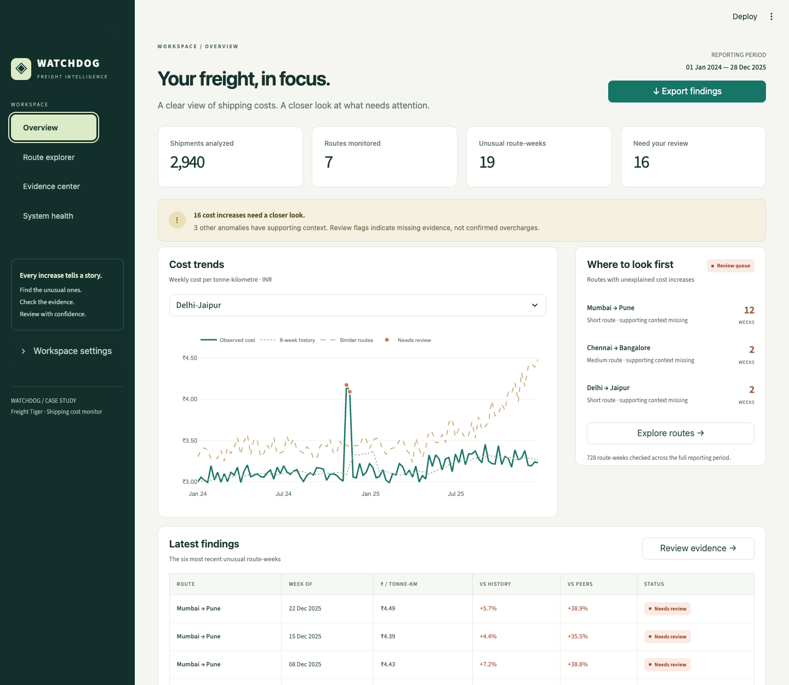
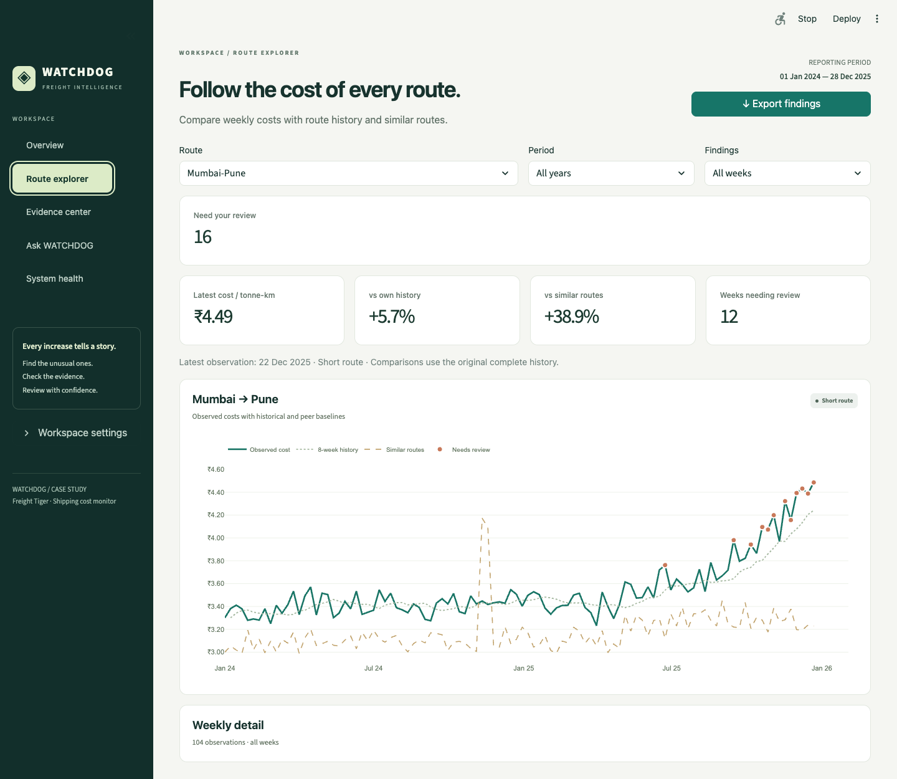
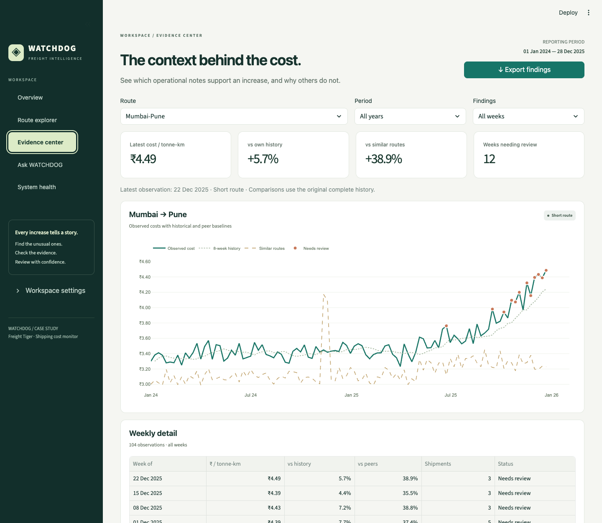
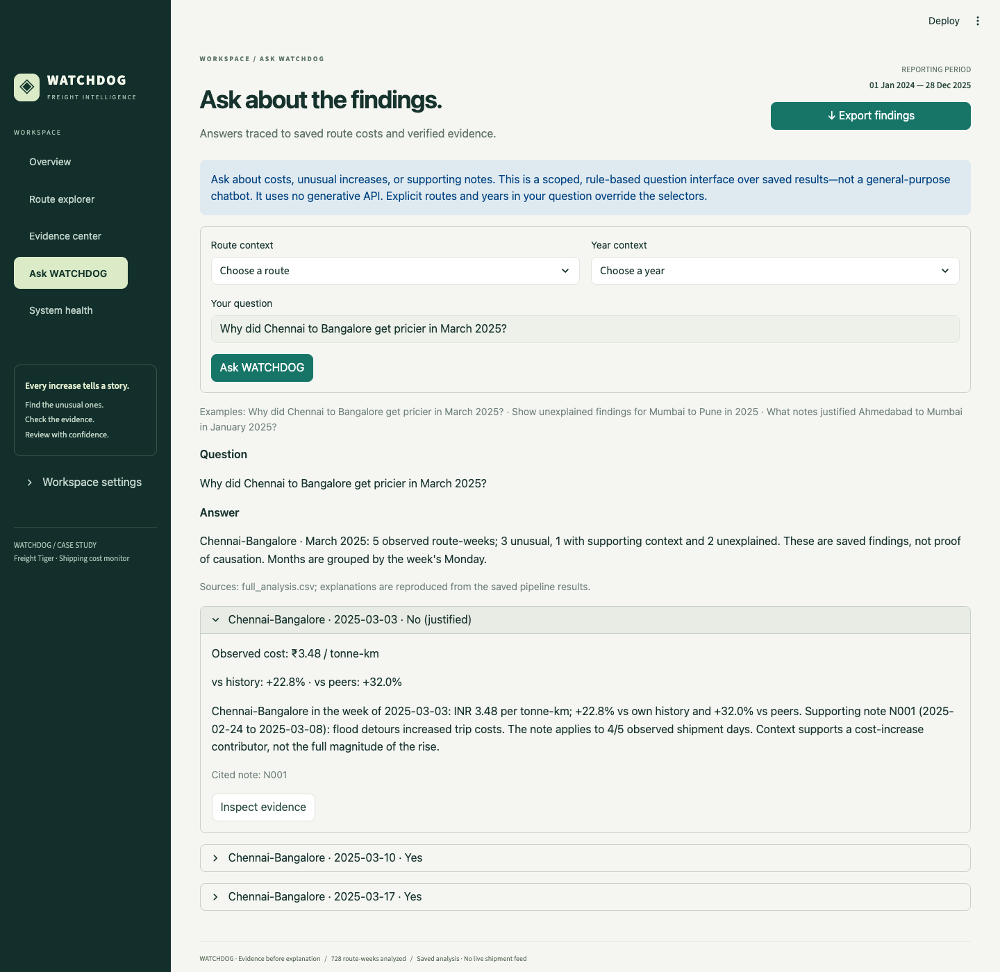
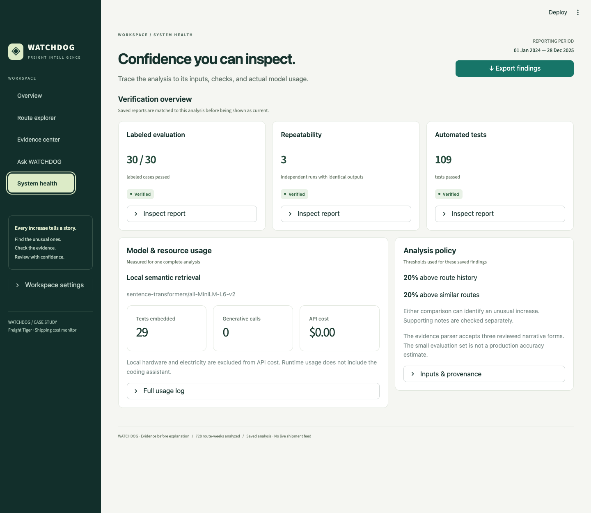
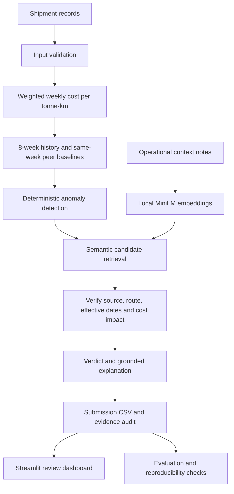

# WATCHDOG: AI-Powered Freight Cost Monitoring & Evidence Review

[](pyproject.toml)
[](app.py)
[](src/watchdog_ai/calculations.py)
[](src/watchdog_ai/retrieval.py)
[](app.py)
[](reports/verification.json)

WATCHDOG is an explainable freight cost monitoring application built for Freight Tiger’s Software Engineering Intern (AI) case study. It analyzes shipment costs week by week, detects unusual increases, and retrieves operational notes to check whether those increases have supporting evidence.

The dashboard connects every finding to its numerical comparisons, source notes, and verification results. Calculations and verdicts are deterministic; semantic retrieval runs locally with no API key or paid generative service.

> Find unusual shipping costs. Check the evidence. Understand what needs review.

[Quick Start](#quick-start) · [Dashboard](#dashboard) · [Architecture](#architecture) · [Verified Results](#verified-results) · [Technical Guide](docs/technical-guide.md)

---

## Dashboard

### Freight Overview

Shipment coverage, unusual route-weeks, cost trends, and a prioritized queue of routes with unexplained increases.



### Route Explorer

Filter by route, year, and finding status. Compare observed costs with historical and peer baselines, inspect weekly detail, and open the evidence behind a finding.



### Evidence Center

Review each verdict alongside original notes, effective dates, source checks, and acceptance or rejection reasons. Retrieval similarity is displayed separately from the evidence decision.



### Ask WATCHDOG

Ask questions in plain English about the saved findings, such as **“Why did Chennai to Bangalore get pricier in March 2025?”** Answers show the matching route-weeks, recorded costs, explanations, and note IDs, with direct links to inspect the evidence.



Route and year selectors provide context when omitted from a question. This deterministic question interface supports route/month/year lookup and supported or unexplained findings; it does not generate new explanations, calculate arbitrary aggregates, predict costs, or provide open-ended chat. It asks for clarification when required context is missing. No additional model or API calls are made.

### System Health

Inspect labeled evaluation, repeatability, automated test results, and actual model usage. Saved reports are checked against current artifacts before appearing as verified.



---

## Architecture



The CLI and dashboard share the same saved analysis. The ten-note collection uses an in-memory embedding matrix; no external vector database or REST backend is required.

## Key Capabilities

| Capability | What WATCHDOG does |
| --- | --- |
| Weekly cost tracking | Aggregates freight cost and tonne-kilometres by directional route and Monday-to-Sunday week. |
| Historical comparisons | Compares each week with observed route rates in the preceding eight calendar weeks, without future data. |
| Peer comparisons | Compares against other routes of the same supplied route type in the same week. |
| Anomaly detection | Applies explicit, configurable thresholds; the default is 20% above history or peers, subject to the rising-cost policy. |
| Local semantic retrieval | Uses 384-dimensional MiniLM embeddings to rank relevant context notes. |
| Evidence verification | Checks source fingerprints, route applicability, effective dates, and supported cost impact. |
| Traceable explanations | Includes exact note IDs for supported verdicts and marks missing support as unexplained. |
| Questions about findings | Plain-English lookup with explicit route/date scope, exact saved explanations, and evidence links. |
| Review workspace | Provides interactive charts, route filters, evidence inspection, and exact CSV export. |
| Repeatability | Compares five output artifacts across three fresh process executions. |

### Evidence Before Explanation

Semantic similarity proposes candidate notes. It does not decide whether an increase is justified.

A note must pass source, route, date, and cost-impact checks before it can support a verdict. Explanations use verified fields and deterministic templates; no generative LLM writes the final reason.

The evidence parser supports reviewed patterns for three event types from the supplied dataset. It is intentionally narrow: unfamiliar wording may be rejected even when a human would accept it. Supporting context identifies a plausible contributor, not proof that it explains the full price increase.

## Technology Stack

| Layer | Technologies |
| --- | --- |
| Interface | Streamlit, custom CSS, responsive layouts |
| Visualization | Plotly |
| Analytics | Python, pandas, NumPy, `math.fsum` |
| Semantic retrieval | Sentence Transformers, `all-MiniLM-L6-v2`, PyTorch |
| Storage | CSV inputs, CSV/JSON outputs, in-memory embedding matrix |
| Verification | Pytest, Streamlit AppTest, labeled evaluation, SHA-256 checksums |
| Runtime | Local Python environment; no API key required |

## Quick Start

Requires **Python 3.11+**. From a terminal:

```bash
git clone https://github.com/rajatmurhe/WATCHDOG.git
cd WATCHDOG
python3 -m venv .venv
source .venv/bin/activate
python -m pip install -r requirements.txt
python -m watchdog_ai run
streamlit run app.py
```

On Windows, activate the environment with `.venv\Scripts\activate` instead.

Open the local URL printed by Streamlit. The first analysis run downloads the pinned MiniLM model from Hugging Face. Weights remain outside Git in the local model cache. After that download, the pipeline can run offline:

```bash
HF_HUB_OFFLINE=1 python -m watchdog_ai run
```

For custom inputs, thresholds, and the explicitly labeled lexical fallback, see the [technical guide](docs/technical-guide.md#run-it).

## Verified Results

These results describe the supplied case-study dataset and saved verification reports.

| Check | Recorded result |
| --- | --- |
| Input coverage | 2,940 shipments, 7 routes, 104 weeks |
| Weekly analysis | 728 route-weeks |
| Anomalies | 19 total: 3 supported, 16 unexplained |
| Automated tests | 109 passed; zero failures, errors, or skips |
| Labeled evaluation | 30 / 30 cases passed |
| Reproducibility | Five output files identical across three fresh runs |
| Generative usage | Zero LLM calls and zero generative input/output tokens |
| API charges | USD 0; local hardware and electricity excluded |

The evaluation is a small, AI-authored case suite, **not a production accuracy estimate**. The default threshold is a declared policy choice. It has not been established as an optimal business threshold.

Run the complete verification:

```bash
python scripts/verify_submission.py
```

Or run checks individually:

```bash
pytest -q
python -m watchdog_ai evaluate
python -m watchdog_ai reproducibility --runs 3
```

Execution evidence: [test verification](reports/verification.json) · [labeled evaluation](reports/evaluation.json) · [reproducibility](reports/reproducibility.json) · [clean installation](reports/clean_install.json).

The test badge above reflects the checked-in verification report, rather than a live CI run.

## Project Structure

```text
WATCHDOG/
├── app.py                    # Streamlit review workspace
├── assets/dashboard.css      # Dashboard styling
├── .streamlit/config.toml    # Theme configuration
├── src/watchdog_ai/          # Validation, calculations, retrieval and evidence
├── data/                    # Original supplied CSV files
├── evaluation/              # Independent labeled cases
├── tests/                   # Unit and integration tests
├── outputs/                 # Submission, full analysis, audit and usage
├── reports/                 # Executed verification results
├── scripts/                 # End-to-end verification command
└── docs/                    # Technical guide, walkthrough and screenshots
```

## Output Artifacts

| File | Contents |
| --- | --- |
| [submission.csv](outputs/submission.csv) | Anomalous route-weeks in the exact eight-column assignment format |
| [full_analysis.csv](outputs/full_analysis.csv) | All weekly rates, comparisons, counts, statuses, and explanations |
| [evidence_audit.json](outputs/evidence_audit.json) | Ranked notes, similarity scores, fingerprints, and verification decisions |
| [usage.json](outputs/usage.json) | Measured embedding work and generative usage/cost log |
| [manifest.json](outputs/manifest.json) | Input hashes, configuration, versions, and counts |

`Yes` in the submission means an unexplained anomaly. `No (justified)` means an anomaly with applicable supporting evidence. Normal weeks appear in the full analysis.

## Documentation

- [Technical guide: calculations, safeguards, thresholds, and limitations](docs/technical-guide.md)
- [Assignment requirements and implementation decisions](docs/requirements.md)
- [Ten-minute walkthrough and interview preparation](docs/walkthrough.md)
- [Submission checklist](docs/submission_checklist.md)
- [Labeled evaluation cases](evaluation/labeled_cases.csv)

## Development

Developed with OpenAI Codex assistance. The repository records actual implementation milestones. Application usage logs measure the pipeline’s runtime, not coding-assistant usage.
