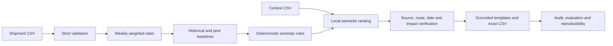

# WATCHDOG — Technical Guide

An explainable freight cost monitor for Freight Tiger's Software Engineering
Intern (AI) case study. WATCHDOG finds unusual route-week costs, retrieves
operational notes, and flags increases that lack verified supporting evidence.
All financial calculations and verdicts are deterministic.

## Run it

Python 3.11+ is required. Run these commands from the repository root:

```bash
python3 -m venv .venv
source .venv/bin/activate
python -m pip install -r requirements.txt
python -m watchdog_ai run
pytest -q
python -m watchdog_ai evaluate
python -m watchdog_ai reproducibility --runs 3
```

The first semantic run downloads the pinned open-source embedding model from
Hugging Face. Model weights stay in the user's Hugging Face cache, outside Git.
No API key or paid generative service is needed. Subsequent runs can use the cache.
After the initial model download, use `HF_HUB_OFFLINE=1 python -m watchdog_ai run`
to avoid network metadata checks and run entirely from the local model cache.

For a lightweight offline installation, use `python -m pip install -e '.[test]'`
and add `--retrieval lexical` to pipeline/evaluation/reproducibility commands.
Use `pytest -q -m 'not embedding'` for that installation. Lexical mode is a
deterministic fallback, **not AI embedding retrieval**. `--retrieval auto` attempts
embeddings and records the exact failure if it falls back. The default `embedding`
mode fails visibly rather than silently switching methods.

```bash
python -m watchdog_ai run --shipments data/shipment_records.csv \
  --notes data/context_notes.csv --template data/sample_output_format_v2.csv \
  --output outputs --retrieval embedding --history-threshold 20 --peer-threshold 20 --top-k 5
```

The installed `watchdog` command is an alias for `python -m watchdog_ai`.
`constraints.txt` records the full dependency versions from the verified Python
3.11 installation; `requirements.txt` applies it to the default setup. Lightweight
installs can also use `python -m pip install -c constraints.txt -e '.[test]'`.

## What is produced

| File | Contents |
| --- | --- |
| `outputs/submission.csv` | Exact eight-column submission; anomalous weeks only |
| `outputs/full_analysis.csv` | All 728 route-weeks, raw comparisons, counts, status, and explanations |
| `outputs/evidence_audit.json` | Ranked candidates, similarity, source fingerprints, and every acceptance/rejection |
| `outputs/usage.json` | Actual retrieval work and zero generative calls/tokens/API cost |
| `outputs/manifest.json` | Input checksums, dependency versions, configuration, and counts |
| `reports/evaluation.json` | Per-case expected/predicted results and threshold sensitivity |
| `reports/reproducibility.json` | Checksums from three fresh process executions |

The supplied dataset contains 2,940 shipments, seven directional routes, ten notes,
and 104 Monday-to-Sunday weeks. Source files in `data/` are preserved unchanged.
The malformed unquoted comma in the sample's last reason is not reproduced.
Only its header is read as the formatting contract.

## Verified results

The final semantic run produces **19 anomalies: 3 supported and 16 unexplained**.
All **147 tests pass**, with no failures or skips, including real embedding inference
and the dashboard. The three official numerical examples match. All 30 evaluation cases pass:
16/16 detection cases, 7/7 route citation decisions (including 3/3 positive note
matches), and zero false justifications across 16 negative support cases. These
are small-case-suite results, not estimates of production accuracy.

Three fresh embedding processes produce byte-identical submission, full analysis,
evidence audit, usage, and manifest files. Submission SHA-256:
`7bf97646c160325d87e34eb175b5afc29d4bb2dd85f401cc83b2cfae6bc3ef26`.
One full run performs two embedding encode calls over 29 texts and 1,152 non-padding
wordpieces, with zero generative calls/tokens and USD 0 API cost.

The tested 10/15/20/25/30% thresholds produce 79/26/19/13/10 anomalies respectively.
The 20% default remains an explicit policy choice. See the machine-readable
[evaluation](../reports/evaluation.json), [reproducibility](../reports/reproducibility.json),
and [verification](../reports/verification.json) reports for actual execution evidence.
The verification report records the test count, environment, checks, and source hashes.
A [second clean installation](../reports/clean_install.json), using pinned wheel artifacts
and the cached model in offline mode, reproduced all five output files exactly.

To regenerate all verification evidence in one command:

```bash
python scripts/verify_submission.py
```

## Architecture



Python, pandas and NumPy handle tabular work. `math.fsum` provides stable totals.
Sentence Transformers supplies local semantic ranking; Pytest tests the behavior.
The small note collection is an in-memory matrix, so there is no vector database
or service infrastructure. The CLI and any interface use the same pipeline.

## Input contract

Shipments require `shipment_id`, `origin`, `destination`, `route_type`, `material`,
`quantity_tonnes`, `distance_km`, `freight_cost_inr`, `shipment_date`, and `transporter`.
Notes require `note_id`, `date`, `applies_to`, and `note`. Dates must be ISO
`YYYY-MM-DD`. IDs must be nonempty and unique. Route type must be the supplied
Short/Medium/Long classification and consistent within a directional route.
Quantities/distances must be finite and positive; freight costs finite and
nonnegative. Zero historical or peer rates cannot define a percentage comparison.
Ambiguous route labels, missing values, inconsistent row widths, and unknown note
routes are rejected with row-specific errors. Invalid rows are never dropped.

`All Routes` is supported note metadata. Individual note routes must match a
dataset route exactly. There is no fuzzy route or reverse-direction substitution.
Empty notes are allowed; an empty shipment file is rejected.

## Calculations

For each `(origin, destination, route_type, week_of)`:

```text
week_of = shipment_date minus its weekday offset (Monday = 0)
weekly_rate = sum(freight_cost_inr) / sum(quantity_tonnes * distance_km)
history = mean(observed weekly rates in [week_of - 56 days, week_of))
peers = mean(other route-week rates with the same route_type and week_of)
deviation_pct = (weekly_rate - baseline) / baseline * 100
```

The rate is INR per tonne-km, not an average of shipment-level rates. Historical
and peer baselines are unweighted averages of **weekly route rates**. The current
week and all future weeks are excluded from history. Before eight prior calendar
weeks exist, only available observations in the window are used. Missing weeks
are not padded, and older observations do not replace missing weeks. Counts are
exported to make sparse history and single-route peer groups visible.

Absent/zero baselines have undefined deviations (`N/A` in submission, blank in
the analysis). Internal binary64 values retain full precision. Display rounding
is two decimals for cost and one for percentages. Independent Decimal arithmetic
tests check every weekly rate; official regression results are:

| Route | Week | Rate | History | Peers |
| --- | --- | ---: | ---: | ---: |
| Delhi-Jaipur | 2024-11-11 | 4.17 | +35.5% | +21.0% |
| Ahmedabad-Mumbai | 2025-01-20 | 3.29 | +29.5% | +22.5% |
| Mumbai-Pune | 2025-09-15 | 3.98 | +9.2% | +23.6% |

## Anomaly policy

A route is rising when its rate exceeds its historical baseline. It is unusual
when either historical or peer deviation meets the configured threshold, initially
20%. With no usable history, a peer anomaly is allowed but its explanation explicitly
states that trend is unavailable. A decline against available history is not flagged
solely because it is expensive relative to peers. Equal-to-threshold values qualify.

Twenty percent is a transparent materiality heuristic, not a learned probability
or a threshold selected to fit the three official rows. The evaluation compares
10/15/20/25/30%; there is no complete anomaly ground truth from which to claim an
optimal threshold. Peer comparisons can flag persistently expensive routes even
when their recent growth is small. Material, transporter and load differences are
not controlled by the assignment's baseline.

## AI retrieval and factual safeguards

The model is
[`sentence-transformers/all-MiniLM-L6-v2`](https://huggingface.co/sentence-transformers/all-MiniLM-L6-v2),
pinned to revision `1110a243fdf4706b3f48f1d95db1a4f5529b4d41`. It produces
384-dimensional sentence embeddings. Normalized dot products give cosine similarity,
as described in the [Sentence Transformers documentation](https://www.sbert.net/docs/sentence_transformer/usage/semantic_textual_similarity.html).
The query includes the route, week, and possible transportation-cost factors.
All notes are embedded once; anomaly queries are encoded in a batch. The five
highest-ranked notes per anomaly proceed to verification. Scores are rounded to
seven decimals for ranking, then tied by note ID. CPU execution uses one thread,
seed zero, and deterministic PyTorch operations. No random generative wording is used.

Similarity only proposes evidence. Verification requires:

1. The note ID, date, route metadata, and complete text match the current source's
   SHA-256 fingerprint. Missing or changed source records fail closed.
2. The directional route matches, or scope is genuinely `All Routes`.
3. The full narrative matches one of three supported event types: dated flood
   detours with recovery, a temporary festival surcharge, or nationwide diesel-driven
   transportation-cost increases. Matching a keyword is insufficient. Additional
   contradictory text, exclusions, normal/recovery-only notes, and unfamiliar prose
   are rejected. There are no production note-ID-to-verdict lookup tables.
4. The inclusive effective dates overlap actual shipment dates. Flooding ends on
   March 8; March 9 recovery cannot justify the following week. Start-only notes
   end at that week's Sunday. Fuel inflation is not an indefinite explanation.

Festival assertions also accept reviewed causal wording such as “Festival demand and limited truck availability led to a temporary freight surcharge on Ahmedabad-Mumbai this week.” The same route, effective-date and source checks apply; negated, uncertain or contradictory versions are rejected.

This parser is deliberately narrow and tailored to the supplied note *forms*.
It is **not general natural-language inference**. A differently phrased genuine
explanation may be rejected until a reviewed grammar and negative tests are added.
This is a known recall trade-off. Retrieval can also miss support outside top-k;
the audit retains candidate scores and rejection reasons for inspection.

A verified note establishes a plausible contributor, not proof that it accounts
for the full price increase. Explanations disclose how many observed shipment days
the note covers. A 5-7% fuel note is never claimed to explain a larger rise in full.

## Explanations and output contract

Deterministic templates use the actual route, week, rate, deviations, accepted
note ID, effective dates, and supported impact. Unsupported rows say no verified
supporting note was found. No LLM rewrites text, so there is no unchecked generated
wording or paid API dependency.

The exact submission columns are:

```text
route,week_of,cost_per_tonne_km,vs_own_history,vs_similar_routes,flagged,matched_note_id,reason
```

`Yes` means an unexplained anomaly. `No (justified)` means an anomaly with applicable
cost-impact evidence. Unexplained IDs are blank. Normal weeks appear only in the
full analysis, avoiding an invented submission verdict. Percent fields retain the
template's wording. Python's CSV writer escapes commas and quotes. Rows are uniquely
sorted by route then Monday date.

## Tests, evaluation and reproducibility

Tests cover invalid data, weighted aggregation, date boundaries, sparse calendars,
no look-ahead, excluded peers, zero/absent baselines, all three official numerical
examples, threshold boundaries, changed source metadata, misleading notes, actual
embedding execution, CLI behavior, CSV round trips, shuffled inputs, and fresh-process
reproducibility. The `embedding` test actually loads and executes the model.

The 30 labeled evaluation cases are authored separately from predictions: three
official examples, flood-window route cases, synthetic normal/boundary cases, and
wrong-route/wrong-date/negated-impact notes. This is a small, AI-authored case suite,
not a statistically representative benchmark. Boundary labels verify the declared
policy; their success does not establish that 20% is the best business threshold.
The JSON report includes all denominators and per-case expected/predicted values.

Reproducibility starts three fresh Python processes with untouched inputs and
compares all five output files byte-for-byte, including explanations and audit scores.
Input/source changes during the check are rejected. It is stronger than comparing
only rounded CSV numbers, but does not establish bitwise portability across every
operating system or future dependency version.

## Usage and cost

Application runtime uses **zero generative LLM calls, zero input/output generative
tokens, and USD 0 in generative API charges**. Local embedding encode calls, texts,
queries and non-padding wordpieces are measured separately after truncation. Local
hardware and electricity are not priced. No hypothetical token estimate is presented
as actual usage. Coding-assistant usage is outside application telemetry and is not
claimed to be zero.

## Review and walkthrough

The optional dashboard reads the saved outputs and uses no separate calculation
engine. Run `streamlit run app.py` after generating the analysis. Five workspace
pages organize the review:

- **Overview:** shipment coverage, unusual weeks, routes needing attention, and recent findings.
- **Route explorer:** route/year/status filters, cost trends, weekly detail, and a direct link to evidence.
- **Evidence center:** verdict, observed comparisons, original notes, and acceptance/rejection reasons.
- **Ask WATCHDOG:** scoped natural-language lookup of saved findings, explanations, and note citations.
- **System health:** evaluation, repeatability, source-matched test reports, and actual model usage.

The dashboard uses a responsive teal-and-neutral theme, distinct status colors,
and an export button that downloads the exact submission CSV. Settings hold the
input artifact directory. Reports are marked stale when outputs or checked source
files change. Layout and colors live in `assets/dashboard.css` and `.streamlit/config.toml`.

- [Requirements and decisions](requirements.md)
- [Ten-minute walkthrough and interview preparation](walkthrough.md)
- [Submission checklist](submission_checklist.md)
- [Evaluation labels](../evaluation/labeled_cases.csv)

This implementation was developed with OpenAI Codex assistance at the user's request.
The commit history records actual completed work, without fabricated timelines or
claims of independent human authorship. The candidate should review the code and
be able to reproduce and explain its assumptions before submission.

## Questions about findings

`questions.py` parses one directional route, year, named month or ISO date and executes a bounded query over `full_analysis.csv`. Explicit route/year mentions override selectors. Months group by the week's Monday; an ISO date selects its containing Monday week, including across New Year. Relative dates, ranges, multiple routes and conflicting filters ask for clarification.

`question_language.py` uses the existing pinned MiniLM model for unfamiliar paraphrases. It embeds reference utterances for six operations (explain, unexplained, supported, summary, costs, compare) plus an unsupported category. The best per-class cosine match must reach 0.48 and exceed the runner-up by 0.045; otherwise it abstains. These are conservative development thresholds, not calibrated confidence or a measured production accuracy. The model loads only from the local cache populated by the embedding pipeline; question submission does not trigger a network download. Reference vectors are cached per process. CPU inference uses one thread, a fixed seed and deterministic algorithms, with evaluation mode. There is no sampling temperature because this is an embedding model, not a generator.

Explicit status/negation phrases and arithmetic operations take precedence over semantic routing. An indirect evidence filter in a calculation can use the semantic router, but it must resolve to supported or unexplained; uncertainty stops the calculation instead of dropping the filter. A model-selected operation cannot supply routes, dates, numbers, note IDs, verdicts or new explanations. Scope is parsed separately and shown to the user. Missing-model errors are visible; explicit queries remain available. Unsupported or unrelated questions can still be misinterpreted by a similarity classifier, so the visible interpretation and conservative abstention are important limits, not a universal language-understanding guarantee.

Available calculations use saved rows: counts of findings or observed route-weeks; highest/lowest weekly rates including ties; median weekly rate; total freight spend; and weighted period cost (sum freight / sum tonne-km), labeled separately from the unweighted mean of weekly rates. Comparisons reproduce the saved history/peer differences. Counts do not pretend to count individual shipments or notes. No new causal claim is generated, even if a question presupposes an increase.

Follow-ups starting with “What about”, “How about”, “Same for” or “And” can reuse the last answer's route, period, operation and status filter. New explicit scope overrides inherited scope. A new standalone question does not silently inherit context. Responses are invalidated when the analysis artifact changes.

Examples:

- Which shipping alerts still need someone to investigate for Chennai to Bangalore in March 2025?
- What pushed transport expenses upwards for Chennai to Bangalore in March 2025?
- What was the average cost for Mumbai to Pune in 2025?
- What about April?
- Compare rates with history and peers for Chennai to Bangalore in March 2025.
- Show costs for Chennai to Bangalore on 2025-03-12.

The UI exposes per-request local embedding calls, non-padding input wordpieces, model revision and similarity/margin, and downloads the session log. The first semantic request includes reference-encoding tokens and an extra encode call; later requests include query inference only. Explicit queries use zero embedding calls. Generative calls/input/output tokens and API charges are zero; local compute and development assistant usage are excluded. `outputs/usage.json` remains the full shipment pipeline log and does not absorb interactive question traffic.

Tests execute the real model on paraphrases separate from routing examples, check exact saved facts and citations, and repeat accepted queries three times. They also cover abstention, model failure, arithmetic with unequal exposure, date boundaries, scope overrides, follow-ups, negation, and UI session accounting. These are development regression cases, not an independent human-authored language benchmark. The assignment audit includes original Q&A checks and new paraphrases, with actual interpretation and usage recorded.
